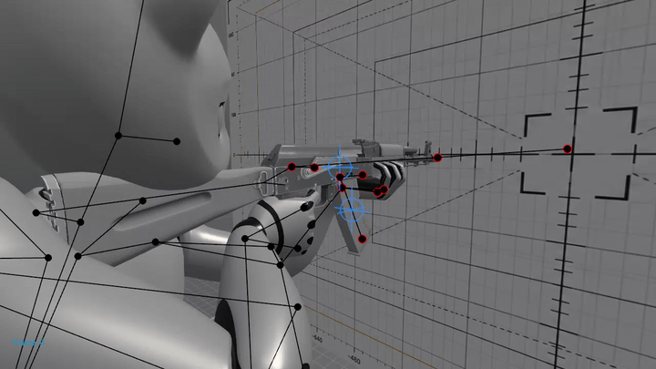
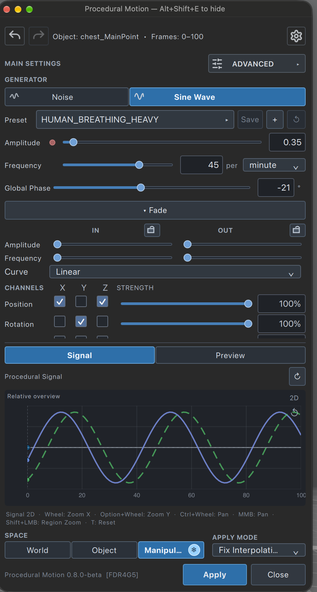
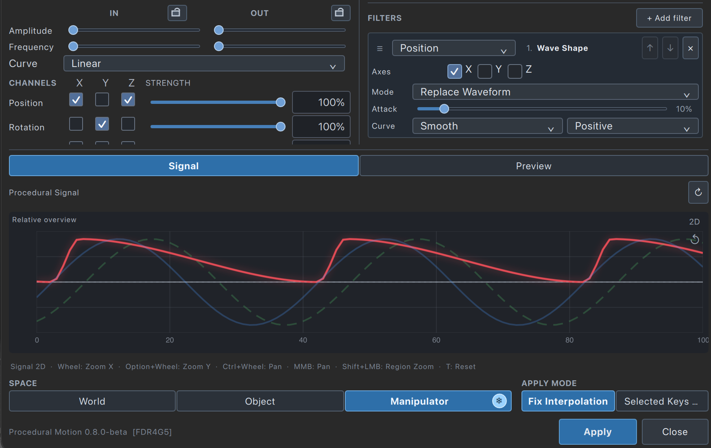
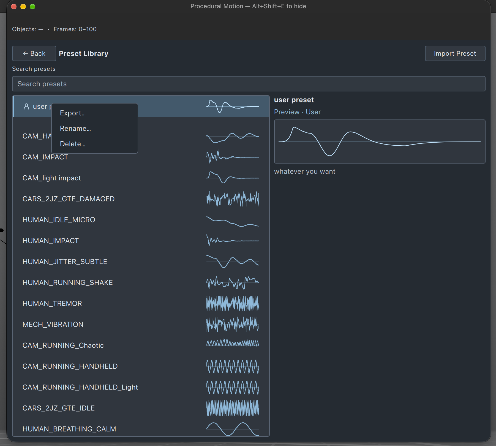

# Procedural Motion

**0.8.0 Community Beta · Build FDR4G5**

💬 [Join the Discord discussion](https://discord.com/channels/553166696916189184/1557580375968972943)

Procedural Motion is an independent community plugin for Cascadeur. It adds procedural motion to selected controllers, from breathing, recoil and idle movement to camera shake and vibration.

Generate breathing, recoil, camera shake, and secondary motion without manually animating every keyframe.

[**Download Procedural Motion 0.8.0 Community Beta**](https://github.com/rdem3d/procedural-motion/releases/tag/v0.8.0-beta)

Download the ZIP from **Assets**, not the automatically generated GitHub Source code ZIP.

**This is an independent Community Beta plugin, not an official Nekki or Cascadeur product.** Back up your scenes and test changes on copies.

*Procedural weapon recoil generated with Procedural Motion.*

## What can you create?

- Character breathing and idle motion.
- Weapon recoil and impact reactions.
- Handheld camera shake.
- Mechanical vibration and secondary motion.

## Features

- **Noise** creates irregular, seeded motion; **Sine Wave** creates repeating motion.
- Position, Rotation and Scale channels, spatial modes, fade, variation and signal previews help shape and inspect movement.
- A searchable Preset Library with Factory and User presets lets you reuse settings and share them through JSON import/export.
- Parameter Overrides adjust individual axes, while ordered, multi-axis Filters shape Sine Wave signals.
- Fix Interpolation and Selected Keys Only apply modes provide control over how motion is applied.

## Requirements and download

Cascadeur **2026.2 or newer** is required. This build has been tested with Cascadeur 2026.2.3 on macOS. Windows and Linux installers are included, but those platforms require further runtime testing.

Download `ProceduralMotion-0.8.0-beta-FDR4G5.zip` from [Releases](https://github.com/rdem3d/procedural-motion/releases). Use the ZIP in **Assets**; the automatically generated source archives contain only this presentation repository.

## Installation

Extract the entire ZIP and close Cascadeur. Keep the installer folders alongside `Plugin`.

- **macOS:** run `./macOS/Install.command` in Terminal from the extracted folder. Its default target is `/Applications/Cascadeur.app`; for a different location, adjust its target path before running.
- **Windows:** run `Windows\Install-Windows.bat` and enter the path to your Cascadeur installation.
- **Linux:** run `./Linux/Install.sh` in a terminal and enter the installation path, or pass it as an argument.

Restart Cascadeur or use **Commands → Reload scripts**. Open **Animation Scripts → Procedural Motion**. Read `START_HERE_EN.pdf` in the ZIP for the first workflow, keyboard shortcuts and troubleshooting; the full English and Russian guides are also included.

## Share presets

Open Preset Library, right-click a preset and select **Export…** to save a JSON file. To import, choose **Import Preset** and select the JSON. It contains settings, not a Cascadeur scene or animation. See the user guide for name conflicts.

## Uninstallation

Close Cascadeur. In its Python installation directory, remove only `models/procedural_noise_sine_wave/`, `scripts/animation_scripts/procedural_noise_sine_wave.py`, and `events/application_started/procedural_motion_start.py`. Restart Cascadeur to clear the in-memory shortcut handler. Leave user data in place to preserve presets and settings. See **Uninstallation** in `USER_GUIDE_EN.pdf` for platform paths and complete removal.

## Known limitations and reporting

This is a beta: errors, freezes or crashes may occur. Apply writes to the scene; verify the result and Undo on a copy. An isolated Additive Layer Fixed + value test produced an Undo error. Preview is approximate and the rig or solver may change the final pose. Windows and Linux require more testing.

Please use [GitHub Issues](https://github.com/rdem3d/procedural-motion/issues) for bug reports. Include OS, Cascadeur version, build ID, steps, selected controllers and range, preset, expected and actual behavior, and relevant logs or screenshots. Review files for private information before sharing.

[Краткая инструкция на русском](README_RU.md)
